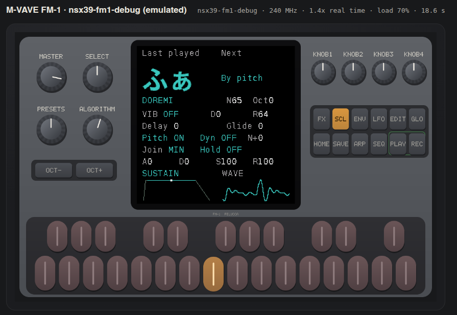

# Gakken NSX39 Pocket-Miku Firmware For M-VAVE FM-1



Device Flashing Page: <https://al-255.github.io/nsx39-fm1-firmware/>

## Use

0. Buy a NSX39, open it, and dump the SPI Flash (MX25L series),
1. Open the generator and select your own NSX39 SPI dump.
2. Generate`.fwsc` update image.
3. Upload the image to [FM-1 emulator](https://joakimeriksson.github.io/fm1-emu/) 
   or test on a real hardware.sEx MIDI access.
   Installation begins only after this explicit action.

Supported input is the analyzed 2,097,152-byte flash image, optionally followed
by the 272-byte programmer trailer. Flash SHA-256:
`4e9b8eb35198f2b809fa49f9c704a8982ec6b5fa6cd610c4bde807d8fb02a9e4`.
Unknown or modified flash contents are rejected, including user-edited persistent
slots. Supporting other revisions requires an explicit validated profile.

On the FM-1:

| Control | Debug behavior |
|---|---|
| ALGORITHM encoder | Selectable syllable → DoReMi → Lyrics 00–15 |
| SELECT encoder | Manual: pronunciation 0–127, wrapping. Lyric: left restarts, right reserved |
| PRESETS encoder | Cycle hiragana, katakana and romaji labels |
| 27 keys | Monophonic trigger/pitch; each new key press advances one lyric syllable |
| OCT− / OCT+ | Three registers: MIDI 53–79 (default OCT0), 65–91, 77–103 |
| Both OCT buttons, short press | Toggle settings; knob 1 selects an item, knob 2 changes it |
| Knobs 1–4 | Attack / decay / sustain / release; live amplitude envelope |
| LFO / EDIT / GLO / HOME / REC | Vibrato on/off / type / rate / delay / depth |
| SCL / ENV | Automatic pitch / automatic dynamics switches (native approximations) |
| FX / ARP / SEQ / PLAY | Recorded-noise level / connection timing / glide / sustain hold |
| MASTER | Output level |
| SAVE | Panic / all sound off |
| Both OCT buttons, held 5 s | Enter UBOOT for recovery |
| USB MIDI and TRS MIDI | Vocal channel 1 note/velocity/CC/bend |


## Proprietary Blob

The generator validates the NSX39 ROM dump, XOR-decodes its NSXP body, parses the serialized
vocal database, pronunciation packets and factory lyric defaults, decodes PCM/Yamaha ADPCM, then creates
an FM-1 voice bank. All of that runs in a browser worker. No original executable
code is copied into the result: the synthesis engine is this project's C code.

The bank contains all **449 units / 744,945 decoded samples**, paired source pitch
and stretch streams, four modulation curves, and all **128 pronunciation strings**,
and the 1,024-byte original factory lyric table.
The 36 tiny sustained cycles stay **lossless PCM16**; 413 transitions use standard
IMA ADPCM in independently seeded **128-sample blocks**, 68 bytes each. This is
lossy for transitions. The tested bank occupies **483,052 bytes** of a 491,520-byte
reserve, plus a 1,120-byte settings seed. Aggregate codec SNR against exact decoded input is **24.61 dB**; that
measures the codec, not fidelity to the complete original synthesizer.

The native renderer decodes a transition when it is selected into one of two
bounded 8,192-sample buffers. No heap or unbounded decoding runs in the audio path.
The firmware uses about **55 KB normal RAM**, **118 KB buffer pool**, and a
**566 KB app image**, inside the fixed 581,564-byte app slot. Audio renders at
22,050 Hz and is interpolated to the FM-1's approximately 44.1 kHz output.

## Build locally

Linux x86-64, Python 3 with Pillow, Node.js 20+, a C compiler, Clang/wasm-ld and
DejaVu Sans Mono and Noto Sans CJK JP Bold are required. The hardware compiler is JieLi's pi32v2 compiler.
No system-wide installation is required for it. Download instructions are in
[BUILDING.md](docs/BUILDING.md).

```sh
python3 tools/build.py              # blank app + open-source loader + template
python3 tools/build_web.py          # same vocal engine, WebAssembly
npm test                           # no npm dependencies
python3 tools/prepare_pages.py      # creates an empty/new dist/ via allowlist
python3 -m http.server 8000 -d dist
```

For private local integration tests, use your own dump; all outputs remain ignored:

```sh
node tools/generate.mjs /path/to/NSX39_MX25L1635E.BIN
node tests/integration.mjs /path/to/NSX39_MX25L1635E.BIN
cc -O1 -g -fsanitize=address,undefined -Ifirmware/include -Ibuild/gen \
  tests/core.c firmware/src/voice.c -o build/core_asan
build/core_asan local/voice.bank
```

## Updates and validation

The two-stage updater and RAM-resident loader are reused from
[Felucca](https://github.com/hugelton/Felucca). The loader verifies layout, chip key,
whole-package CRC and sector consistency before replacing the application;
it preserves flash `[0,0x4000)` and verifies written sectors. The application
can write only the five OTA staging sectors and two separate settings-journal
sectors. No NSX39 firmware-update command is forwarded to flash.
A failed or interrupted transfer must be resumed with the **same generated
package**. Read [update safety](docs/UPDATES.md) before hardware tests.

The web installer shows progress for loader staging, full-package verification,
application transfer, and restart/identity confirmation. It also shows the device,
bytes sent, request count, elapsed time, average transfer rate and last response
age. Waiting for USB reconnection uses an indeterminate bar; success requires the
expected firmware identity. Percentages describe the current transfer stage.

Tests cover lyric stepping/looping/rewind, reserved SELECT direction, MIDI channel
isolation, preview state, cross-language codec agreement, malformed input and completion gates,
all 128 pronunciations, C sanitizers, package round trips, and exact native/WASM
output agreement at MIDI 53, 65, 69, 77, 91 and 103. Upstream updater tests cover
wrong-board images, corruption, changed transfer sectors, chip-key mismatch,
interrupted staging, preservation of the boot head/user data, and repeat-install
no-op behavior. See [validation](docs/VALIDATION.md) for limits and reproduction.

GitHub Actions builds and tests without any NSX39 input, then deploys an allowlisted
static artifact to Pages. Deployment requires Pages with source **GitHub Actions**.
No dump, recording, derived bank or generated user firmware enters public CI.

## References and credits

- [NSX39-Disasm](https://github.com/AL-255/NSX39-Disasm): recovered firmware layout,
  database grammar, Yamaha source decoder, source periods, grains and controller behavior.
- [Felucca](https://github.com/hugelton/Felucca): GPL FM-1 hardware layer,
  freestanding runtime, package builder, USB-MIDI updater and recoverable loader.
- [FM-1 emulator](https://joakimeriksson.github.io/fm1-emu/) /
  [source](https://github.com/joakimeriksson/fm1-emu): runs the actual `.fwsc` package;
  primary integration test environment.
- [FM-1-RE](https://github.com/AL-255/FM-1-RE): hardware, flash layout and OTA research.
- [FM-1-transporter](https://github.com/kurogedelic/FM-1-transporter): recovery tooling.
- [JieLi AC79 SDK](https://gitee.com/Jieli-Tech/fw-AC79_AIoT_SDK): Apache-2.0 packaging files.

No affiliation with Yamaha, Gakken or M-VAVE.
